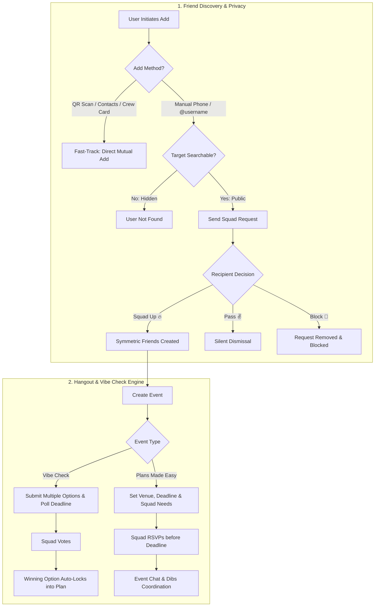

# thanks for the invite — tfti (`tfti.app`)

<p align="center">
  
</p>

<p align="center">
  <strong>The low-friction social coordination and friend circle platform.</strong><br>
  <em>"Set it and forget it" broadcast invites, dynamic squad circles, automated RSVP deadlines, and democratic vibe checks.</em>
</p>

<p align="center">
  
  
  
  
  
  
  
</p>

---

## 📖 Table of Contents

- [Overview & Philosophy](#-overview--philosophy)
- [Key Features](#-key-features)
  - [1. Plans Made Easy (Hangout Coordination)](#1-plans-made-easy-hangout-coordination)
  - [2. Vibe Checks (Democratic Polling)](#2-vibe-checks-democratic-polling)
  - [3. Squad Circles & Social Graph](#3-squad-circles--social-graph)
  - [4. Squad Request Security & Privacy Shield](#4-squad-request-security--privacy-shield)
  - [5. TCG Profile Cards & In-Person QR Sharing](#5-tcg-profile-cards--in-person-qr-sharing)
  - [6. Recurring Seasons](#6-recurring-seasons)
  - [7. Adaptive UI & Smart Badges](#7-adaptive-ui--smart-badges)
  - [8. Web App & App Store Compliance](#8-web-app--app-store-compliance)
- [Architecture & Workflow](#-architecture--workflow)
- [Technology Stack](#-technology-stack)
- [Project Structure](#-project-structure)
- [Getting Started](#-getting-started)
  - [Prerequisites](#prerequisites)
  - [Installation](#installation)
  - [Firebase & Security Rules Setup](#firebase--security-rules-setup)
- [Testing & Quality Assurance](#-testing--quality-assurance)
- [Frequently Asked Questions (FAQ)](#-frequently-asked-questions-faq)
- [License](#-license)

---

## 💡 Overview & Philosophy

Modern group chats are broken for planning hangouts. They drown in endless back-and-forth debates, awkward opt-ins, forgotten dates, and missed connections.

**TFTI** solves social coordination by turning plans into actionable, self-driving events:
- **Zero-Friction Invitations**: Send an invite once to specific circles (e.g., *"Hoops Crew"*, *"Board Gamers"*, *"Dinner Club"*).
- **Hard RSVP Deadlines**: No more guessing headcounts. When the deadline passes, friends who haven't responded are automatically marked as missed out.
- **Democratic Vibe Checks**: Throw out ideas when you aren't sure where to go. The group votes, and the winning venue automatically locks into a concrete event.
- **Privacy & Security by Design**: Guard against unsolicited phone enumeration and spam with a hybrid consent architecture that pairs mutual approval flows with high-trust fast tracks.

---

## ✨ Key Features

### 1. Plans Made Easy (Hangout Coordination)
- **Places Autocomplete & Favorites**: Integrated with Google Places API to search venues instantly, with the ability to star locations and assign custom nicknames (e.g., *"The Spot"*, *"Dave's Garage"*).
- **Dynamic RSVP Deadlines**: Set deadlines ranging from 4 hours before to 4 hours after event start. Unanswered RSVPs expire gracefully.
- **Squad Needs (Dibs System)**: Create interactive lists of food, gear, or party favors. Guests can claim and call dibs directly from the event page.
- **Co-Captains**: Designate a co-host with permission to invite their own circles or manage squad needs.
- **Time-Locked Edits**: Event updates automatically lock once the scheduled end time passes, preserving historical event integrity while allowing real-time chat updates to continue.
- **Real-Time Event Chat & Message Editing**: Coordinate with quick emoji reactions, @mentions, and an inline message editor for authors to revise messages with server-stamped edit tracking (`(edited)`) while preserving guest mentions.
- **Calendar Integration**: Export confirmed hangouts directly to Apple Calendar or Google Calendar via `add_2_calendar`.

### 2. Vibe Checks (Democratic Polling)
- **Feeler Polls**: Propose multiple activity or venue choices when plans are still up in the air.
- **Automated Lock-In**: Once the voting countdown expires, the option with the most votes automatically converts into a locked-in hangout.
- **Captain Tie-Breaker**: Built-in tie-breaking mechanics empower the host to cast the deciding vote.

### 3. Squad Circles & Social Graph
- **Dynamic Circles**: Segment your friends into custom interest-based circles so notifications only reach the people who care.
- **Streamlined Team Creation Flow**: Type-safe modal return architecture (`CreateTeamSheet.showCreate<T>`) enabling instantaneous selection and navigation to newly created circles across mobile portrait and split-view landscape layouts.
- **Goated Friends**: Mark your favorite / best friends as "Goated" (⭐) to highlight them in feeds and filter event views.
- **Contextual Empty States & Shimmer Skeletons**: Fluid animations and informative empty cards guide users when their squad or circles are fresh.

### 4. Squad Request Security & Privacy Shield
A multi-layered defense system that blocks random phone scraping and unsolicited invites:
- **Hybrid Source-Aware Gating**:
  - ⚡ **Fast-Track (Instant Direct Add)**: In-person QR code scans, physical device contact imports, and fellow event guests (Crew Cards) connect immediately.
  - 🛡️ **Slow-Track (Consent Required)**: Manual `@username` or phone number lookups generate an incoming `SquadRequest` requiring mutual approval.
- **Request Lifecycle**:
  - **Squad Up 🔥**: Confirms the connection and symmetrically links friends in both users' squads.
  - **Pass ✌️**: Silently dismisses the request without notifying or embarrassing the sender.
  - **Block 🚫**: Dismisses the request and prevents future attempts by adding the user to an encrypted blocklist.
  - **14-Day Expiration (TTL)**: Unanswered requests automatically expire after 14 days, preventing orphaned queue clutter.
- **Phone Privacy Toggle ("Show to Squad")**:
  - Located in Account Settings, this toggle controls both profile phone display and manual phone search discoverability (`isSearchableByPhone`).
  - Defaults to public with an automatic one-time upgrade migration, allowing users to opt out whenever they desire.

### 5. TCG Profile Cards & In-Person QR Sharing
- **Gamified Identity Cards**: Custom Trading Card Game (TCG) style user profiles displaying HP, Mana, and computed Power Score:
  $$\text{Power Score} = (\text{HP} \times 0.6) + (\text{Mana} \times 0.4)$$
- **Custom Signature Colors & Moods**: Express your identity with custom palette chips, statuses, and custom avatars.
- **In-Person QR Code Scanner**: Built-in `mobile_scanner` and `qr_flutter` modules allow instantaneous in-person friend additions (`tfti://add/@username`).

### 6. Recurring Seasons
- **Ongoing Leagues & Hangouts**: Set up recurring event series (seasons) with automated scheduling and co-host administrative privileges.

### 7. Adaptive UI & Smart Badges
- **Orientation & Multi-Window Support**: Seamlessly transitions between a portrait bottom `NavigationBar` with single-column feed and a landscape `NavigationRail` with dual-pane split screens for foldables and tablets.
- **Ghost Badge Prevention**: App badge counters cross-reference real-time RSVP deadlines to eliminate phantom unread notification badges.

### 8. Web App & App Store Compliance
- **Firebase Web Hosting**: Fully integrated web client deployed directly via Firebase Hosting at `https://tfti-app.web.app`.
- **First-Party Authentication**: Seamless phone SMS OTP authentication on the web with invisible reCAPTCHA anti-bot shielding (zero requirement for 3rd-party social logins).
- **Public Legal & Store Compliance**:
  - [Privacy Policy](https://tfti-app.web.app/privacy): Detailed disclosure of data collection, storage, and user rights.
  - [Terms of Service](https://tfti-app.web.app/terms): User conduct and circle coordination terms.
  - [Support & FAQ](https://tfti-app.web.app/support): Help center and technical inquiries (`tfti.bearmoose@gmail.com`).
  - [Account Deletion](https://tfti-app.web.app/delete-account): Web-accessible deletion instructions satisfying Apple App Store Guideline 5.1.1(v).
- **Social Link Previews**: Rich Open Graph and Twitter Card tags for crisp link previews across iMessage, WhatsApp, Slack, Discord, and Twitter/X.
- **Google Calendar Web Integration**: Instant web event creation via standard Google Calendar URL templates.
- **Responsive Layout & Polished Presentation**: Adaptive container constraints across desktop browsers, iPads/tablets, and mobile viewports with centered cards, dedicated scroll boundaries, and overflow-safe footer links.
- **Platform-Aware Media Delivery**: Dual-engine image rendering (`AppBannerImage`, `AppAvatar`) using native browser HTTP caching on web to avoid IndexedDB/Blob URL detachment across route transitions, paired with Cloud Storage CORS bucket rules (`cors.json`) so Flutter Web's WebGL (`CanvasKit`/`Skwasm`) renderer can decode cross-origin avatars, event banners, and chat photos.
- **Server-Proxied Location & Place Previews**: Callable Cloud Functions (`placesAutocomplete`, `placesTextSearch`, `placeDetails`) proxy Google Places API queries server-to-server and inline Place Photos and Static Map pin thumbnails as base64 data URLs, keeping API keys off the client and bypassing third-party browser CORS restrictions.
- **Cross-Platform Byte Uploads**: Decoupled file handling with `Uint8List` byte streams, eliminating `dart:io` `File` limitations across Flutter Web, desktop, and mobile for user avatars, event banners, and in-chat photos.

---

## 🏗 Architecture & Workflow



---

## 🛠 Technology Stack

| Layer | Technologies / Packages | Purpose |
| :--- | :--- | :--- |
| **Framework** | Flutter 3.x, Dart 3.x | Cross-platform mobile development (iOS & Android) |
| **Design & UI** | Material 3, `material_symbols_icons`, `shimmer`, `smooth_page_indicator` | Adaptive layouts, icon sets, loading animations |
| **Authentication** | Firebase Authentication, `intl_phone_field` | Phone number authentication with international SMS OTP |
| **Database** | Cloud Firestore | Real-time database with declarative security rules |
| **Push & Badges** | `firebase_messaging` (FCM), `flutter_app_badger` | Notifications and smart badge counter management |
| **Media & Storage** | `firebase_storage`, `image_picker`, `image_cropper`, `flutter_image_compress` | Profile photos and event attachments |
| **Hardware / Sensors** | `mobile_scanner`, `qr_flutter` | High-speed QR code generation and camera scanning |
| **Device Integration** | `flutter_contacts`, `add_2_calendar`, `url_launcher` | Address book imports and native calendar syncing |
| **Location & Maps** | Google Maps Platform Places API, `cloud_functions`, `http` | Server-proxied location search, place details, and favorite place autocomplete |
| **Monetization** | `purchases_flutter` (RevenueCat) | In-app purchases and supporter tip jar |

---

## 📁 Project Structure

```text
tftiapp/
├── assets/
│   └── icon/                     # App launcher icons and splash assets
├── functions/                    # Cloud Functions for Firebase triggers, FCM & Places API proxy
├── lib/
│   ├── components/
│   │   ├── account/              # AccountEditCard, settings cards, danger cards
│   │   ├── chat/                 # Chat action dialogs, bubbles, and message input
│   │   ├── details/              # EventCrewCard, hangout details, vibe card
│   │   ├── forms/                # CoCaptainSelector, squad needs, team forms
│   │   ├── shared/               # SharedSliverAppBar, ContextualEmptyCard, UserProfileSheet
│   │   ├── squad/                # SquadRequestsSection, FriendListTile, ContactImportSheet
│   │   └── teams/                # TeamAvatarStack, AddTeamMembersSheet
│   ├── models/                   # SquadRequest, UserProfile, HangoutEvent, Circle
│   ├── pages/
│   │   ├── account_page.dart     # TCG profile card, settings, and phone privacy toggle
│   │   ├── hangout_details_page.dart # Event overview, chat, and RSVP list
│   │   ├── hangout_editor_page.dart  # "Plans Made Easy" creation and edit wizard
│   │   ├── home_page.dart        # Feed view, filter pills, and upcoming event lists
│   │   ├── login_page.dart       # Phone number OTP login & account registration
│   │   ├── squad_page.dart       # Squad requests, friend list, circles, and QR scanner
│   │   └── vibe_check_editor_page.dart # Democratic polling setup wizard
│   ├── services/                 # FriendService, UserService, PlaceService, FeedService
│   ├── utils/                    # AuthService, EventService, CalendarExportHelper, PhoneFormatter
│   ├── firebase_options.dart     # Firebase Flutter configuration
│   └── main.dart                 # App entry point, MainShell, orientation listener
├── test/                         # Comprehensive unit, widget, and compliance test suites
├── web/                          # Web app shell, icons, manifest, and legal compliance pages
│   ├── index.html                # App entry point with Open Graph preview tags
│   ├── manifest.json             # PWA metadata and theme configurations
│   ├── privacy.html              # Public Privacy Policy
│   ├── terms.html                # Public Terms of Service
│   ├── support.html              # Public Support and Help Center
│   └── delete-account.html       # Apple Guideline 5.1.1(v) Account Deletion instructions
├── cors.json                     # Firebase Storage bucket CORS policy (applied via gcloud/gsutil for Flutter Web)
├── firebase.json                 # Firebase CLI project configuration (Hosting, Firestore, Functions)
├── firestore.rules               # Production Firestore Security Rules
└── pubspec.yaml                  # Flutter package dependencies and metadata
```

---

## 🚀 Getting Started

### Prerequisites
- **Flutter SDK**: `^3.10.4` or higher ([Install Flutter](https://docs.flutter.dev/get-started/install))
- **Dart SDK**: `^3.10.4`
- **Xcode** (for iOS, macOS required, iOS 15.0+ deployment target)
- **Android Studio / SDK** (for Android, API 21+ / Lollipop or higher)
- **Firebase CLI**: `npm install -g firebase-tools`

### Installation

1. **Clone the repository**:
   ```bash
   git clone https://github.com/your-username/tftiapp.git
   cd tftiapp
   ```

2. **Install Flutter dependencies**:
   ```bash
   flutter pub get
   ```

3. **Configure Environment Secrets**:
   Ensure you have configured Google Places API keys and RevenueCat credentials in your environment or corresponding configuration files.

### Firebase & Security Rules Setup

1. **Link your Firebase Project**:
   ```bash
   firebase use <your-project-id>
   ```

2. **Deploy Firestore Security Rules**:
   The repository contains strict, production-ready rules in [`firestore.rules`](firestore.rules) covering the new squad requests subcollection and reciprocal friendship authoring:
   ```bash
   firebase deploy --only firestore:rules
   ```

3. **Apply Firebase Storage CORS Configuration (Required for Flutter Web)**:
   [`cors.json`](cors.json) defines the cross-origin headers required for Flutter Web (`CanvasKit`/`Skwasm`) to load avatars, event banners, and chat images from Cloud Storage. Because `firebase deploy` does not apply bucket CORS policies automatically, apply it once via the Google Cloud CLI:
   ```bash
   gcloud storage buckets update gs://tfti-app.firebasestorage.app --cors-file=cors.json
   # Or via gsutil:
   # gsutil cors set cors.json gs://tfti-app.firebasestorage.app
   ```

4. **Deploy Cloud Functions**:
   Deploys background Firestore/FCM triggers and the `cors: true` Callable Functions that proxy Google Places API queries:
   ```bash
   firebase deploy --only functions
   ```

5. **Run or Deploy**:
   ```bash
   # Launch on iOS Simulator
   flutter run -d ios

   # Launch on Android Device/Emulator
   flutter run -d android

   # Launch locally on Web (Chrome)
   flutter run -d chrome

   # Compile & Deploy to Firebase Hosting
   flutter build web --release
   firebase deploy --only hosting
   ```

---

## 🧪 Testing & Quality Assurance

This codebase enforces strict automated testing for logic, models, privacy controls, UI components, responsive layouts, and web store compliance. **141 automated tests** run across the test suite with 100% pass rate.

### Run the Test Suite
```bash
flutter test
```

### Run Static Analysis
```bash
flutter analyze
```

### Test Coverage Highlights
- **Model Tests (`test/models/`)**: Event serialization/deserialization, season recurring generator logic, `HangoutSubmissionRequest` duration & web `Uint8List` byte propagation, 14-day squad request expiration TTL calculations, and phone privacy parsing.
- **Component Tests (`test/components/`)**:
  - `account_edit_card_test.dart`: Phone privacy toggle, modal explanations, and auto-save handlers.
  - `account_settings_card_test.dart`: Preferences, legal document navigation (Terms & Privacy web URLs), and tip jar callbacks with Material splash safety.
  - `auth_ui_components_test.dart`: Text field validation, dynamic loading button states, and clickable checkbox terms/privacy links.
  - `create_team_sheet_test.dart`: Generic return value resolution (`showCreate<T>`), validation, and empty-input protection.
  - `team_card_test.dart`: Team avatar rendering, member count chips, and interactive selection.
  - `message_options_sheet_test.dart`: Quick emoji reactions, text copying, message deletion, and author message editing dialog with @mention preservation.
  - `app_banner_image_test.dart`: Platform-aware image caching (native HTTP on web vs CachedNetworkImage on mobile) and graceful gradient fallback.
  - `banner_picker_test.dart`: Image picking options sheet, web `Uint8List` byte propagation, removal callbacks, and past-event guards.
  - `squad_requests_section_test.dart`: Rendering and tap interactions for **Squad Up**, **Pass**, and **Block**.
  - `friend_list_tile_test.dart`: Friend row layout, status badges, and action triggers.
  - `swipe_rsvp_widget_test.dart` & `critical_alert_banner_test.dart`: Haptic RSVP swipe mechanics and urgent notification banners.
- **Page & Layout Tests (`test/pages/`, `test/`)**:
  - `team_members_page_test.dart`: SafeArea notch clearance and `SharedSliverAppBar` expanded title offset spacing relative to back buttons.
  - `login_page_validation_test.dart`: Phone number OTP validation, responsive maxWidth constraint (440px on web/desktop/tablets), and mobile viewport overflow safety.
  - `onboarding_tutorial_test.dart`: Multi-slide carousel progression and landscape stability.
  - `orientation_layout_test.dart`: NavigationRail / NavigationBar switching, app bar shrinkage (140px to 56px), and form state persistence across orientation flips.
- **Service & Utility Tests (`test/services/`, `test/utils/`)**:
  - `contact_service_test.dart`: Normalization of 10-digit, 11-digit, and international numbers; web safety guards.
  - `calendar_export_helper_test.dart`: Google Calendar template URL construction, ISO timestamp formatting, and special character/emoji encoding.
  - `phone_formatter_test.dart`: Local and international beautification logic.
  - `feed_filter_utils_test.dart` & `feed_service_test.dart`: Feed sorting, circle filtering, and empty-state handling.
  - `theme_provider_test.dart`: Dynamic palette brightness, contrast, and theme persistence.
  - `user_cache_repository_test.dart`: Memory and SharedPreferences cache eviction and TTL management.
- **Web & Compliance Tests (`test/web/`)**:
  - `web_assets_test.dart`: Automated verification ensuring `privacy.html`, `terms.html`, `support.html`, `delete-account.html`, `manifest.json`, favicons, `cors.json` storage headers, and `firebase.json` hosting rewrites exist, parse cleanly, and satisfy Apple App Store & Google Play requirements.

---

## ❓ Frequently Asked Questions (FAQ)

<details>
<summary><strong>How does the Squad Request feature protect users from phone spam?</strong></summary>

When a user tries to add someone by typing a raw phone number or `@username`, the recipient's identity details are masked and an incoming Squad Request is generated instead of immediately adding them. The recipient can review the request and choose to **Squad Up**, **Pass** (silently dismisses without alert), or **Block**. If the target user has opted out of phone searchability via their "Show to Squad" toggle, manual searches return "User not found".
</details>

<details>
<summary><strong>What happens if a friend doesn't respond to a squad request?</strong></summary>

Squad requests feature an automated 14-day expiration time-to-live (TTL). Any request older than 14 days is automatically filtered out from the incoming queue, preventing stale or orphaned requests from cluttering the UI.
</details>

<details>
<summary><strong>How do Vibe Checks decide the winning venue?</strong></summary>

When the host's specified voting countdown ends, a background evaluation tallies all votes. The venue with the highest number of votes is locked in and transformed into a formal hangout with calendar export and RSVP tracking. In the event of a tie, the host (Captain) has exclusive tie-breaker authority.
</details>

<details>
<summary><strong>What are "Squad Needs"?</strong></summary>

"Squad Needs" is an interactive checklist for party supplies, food, drinks, or equipment. Anyone invited can tap "Claim" to call dibs on bringing an item, preventing duplicate purchases and streamlining event planning.
</details>

<details>
<summary><strong>How does TFTI eliminate "Ghost Badges"?</strong></summary>

Rather than relying solely on server counter increments, `MainShell` cross-references pending invitations against active event dates and RSVP deadlines. Invitations for events that have already passed or exceeded their deadline are disregarded, ensuring the app icon badge count reflects only actionable invites.
</details>

---

## 📄 License

Copyright &copy; 2026 TFTI App. All rights reserved.  
This project and its source code are proprietary and confidential. Unauthorized copying, distribution, or modification is strictly prohibited.